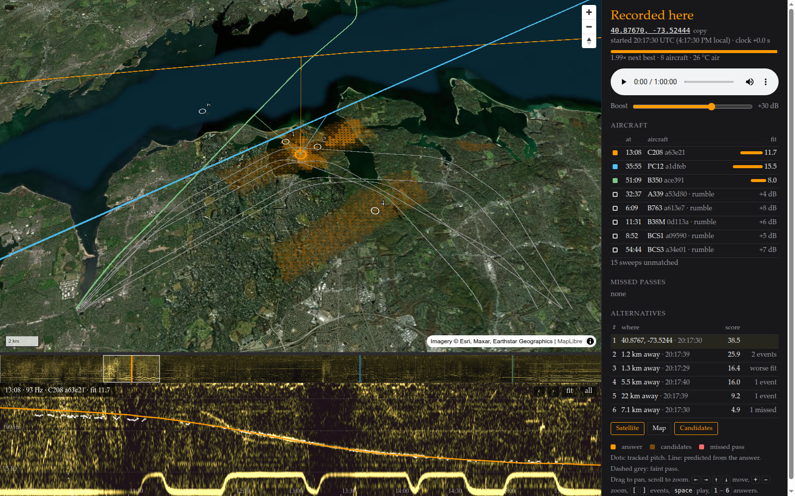

# doppler-locate

> [!IMPORTANT]
> Some of this code was written by Claude Opus 5.5 and Fable 5.2.

Did you know that the change in pitch of overhead aircraft leaks your positions
in most videos that you record? With a little bit of effort, you can deduce the
approximate position (within 1km) just by knowing the date that a video was recorded.

This is my own implementation of the idea in colsto's video
["I discovered a sound that leaks your exact location"](https://www.youtube.com/watch?v=UytYrhYLOKI).
The method is mostly his, but I made several changes to make the code more
automated and performant. Also, I was able to extend his idea to *jet* aircraft
and not just propeller-driven aircraft. More on that below.



## Problem

A propeller makes a steady tone. As the plane passes, the tone you hear drops in pitch (Doppler)
Most aircraft broadcast their position every second or so. These tracks are archived and public.

So a recording with a plane in it carries a fingerprint of the place. Given the audio and the date, which spot
on the map would have heard exactly these pitch curves at exactly these moments?

The original video does this by hand over months of work. This repo does it automatically in seconds to minutes.

## Method

1. Find the passes. Make a spectrogram, follow the tones that fall in pitch, and fit each one as a straight
   flyby to get a rough speed, distance and time of closest approach.
2. List the candidates. For each pass, every flight of about that speed could be the source, from places at
   about that distance. That gives strips of 200 m cells beside each track. Places that two passes agree on,
   with the same recording start time, go first.
3. Check the real geometry. For each candidate, predict the pitch curve from the flight's actual path (it is
   rarely straight), with the sound delay and the terrain height, and compare it with what was tracked.
4. Score each place by everything it explains: tracked passes, passes too faint to track but present along
   their predicted curve, and aircraft with no tone at all (jets) that show up as a rise in level at the
   right moment. Loud passes that should be there and are not count against it.
5. Report the best place, how far ahead of the next one it is, and whether that is enough to call it.

Sound speed matters at the 100 m level. The search obtains the air temperature from open-meteo and
lets the air cool with height. If the lookup fails it fits the temperature from the audio.

Large areas are cut into coarse 100 km tiles, and the best of all tiles get a closer, fine-grained look.

## How-To

Needs Python 3.10+, `ffmpeg`, and `g++` with OpenMP (a small C++ kernel compiles on first run).

```
pip install -r requirements.txt
```

Flight tracks come from [adsb.lol](https://adsb.lol)'s daily archives. Index a day once (streams about 3.5 GB,
keeps about 2 GB):

```
python -m doppler adsb-index --date 2026-09-08
```

Then search. If you know when the clip starts:

```
python -m doppler find clip.m4a --center 40.87 -73.5 --radius 30 \
    --start 2026-09-08T20:17:30Z --clock-tol 30 --viz out
```

If you only know the day:

```
python -m doppler find clip.m4a --center 40.87 -73.5 --radius 30 --date 2026-09-08 --viz out
```

It prints the ranked places and writes a viewer to `out/index.html` (map, spectrogram, the aircraft it matched).
`--radius` is in km; `--bbox` takes a box instead. `--temp` sets the ground temperature yourself.

There is also a local web page that does the same from a file or a YouTube link (`pip install -U yt-dlp`):

```
python samples/get_samples.py --synth   # two synthetic clips
python -m doppler serve                 # http://127.0.0.1:8080
```

To repeat the video's example, the recording is linked from its description
([youtu.be/4CxVxuMVkMc](https://youtu.be/4CxVxuMVkMc)).

## Limitations

Below are the results from some simulated clips over London and New York traffic. Share of trials where
the top answer is within 1 km of the truth, by search radius:

| clip | 20 km | 60 km | 150 km |
|---|---|---|---|
| 1 min | 52% | 42% | 42% |
| 5 min | 75% | 65% | 56% |
| 15 min | 81% | 73% | 69% |

- It needs propeller planes or helicopters. Jets only add weak support.
- It needs the date, and the aircraft has to be in the public data. Many small planes are not.
- One pass alone usually fits several places. Two or more passes pin it down.
- Speech, wind, traffic and hum hide the tones or imitate them.
- The answer moves about 100 m for every 3 °C of error in the air temperature when the planes are far away.
- A whole day over the whole US takes an hour or more on a modern desktop.

## Q-A

**Will it find where my video was filmed?**
Probably not. You need a quiet outdoor recording, a prop plane passing within a few km, and the date.

**How close does it get?**
On the video's recording, the three aircraft it matched agree on one spot to about 150 m. The video gives its
own answer only to two decimals, so I can't really check more closely than that.

**Why do you need the date?**
The flight archive is by day, without the date I have nothing to compare against.

**How do I stop this working on my own recordings?**
See the original YouTube video.

**Why not jets?**
They make broadband noise, not a clean tone, so there is no pitch curve to
follow. You *should* be able to look at the amplitude and infer an approximate
distance and then triangulate, but in my limited testing this is a very noisy
signal.
